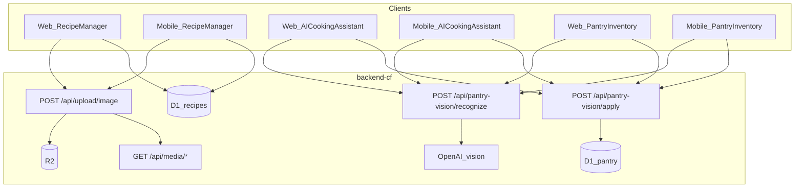

# Technical Design: Client image upload parity

**Feature reference:** [client-image-upload-parity.md](../features/client-image-upload-parity.md)  
**Status:** Ready for implementation  
**Scope:** `frontend/` + `mobile/` clients against existing `backend-cf` upload + pantry-vision routes  
**Out of scope:** Backend route/schema changes, multimodal chat, Cloudinary

---

## 1. Architecture overview



Two independent pipelines share the monthly `image_uploads` quota counter on the server.

---

## 2. Data / contracts

### 2.1 Recipe image (R2)

No schema change. Recipes already have `image_url`, `image_public_id`.

**Client write shape (preferred for mobile serialize):**

```json
{
  "image_url": "https://…/api/media/{userId}/{uuid}.jpg",
  "image_public_id": "{userId}/{uuid}.jpg"
}
```

Web may continue nested `image: { url, public_id }` (backend `parseImage` accepts both).

### 2.2 Pantry vision

Unchanged request/response from `backend-cf/src/routes/pantry-vision.ts`.

- Recognize: multipart `image` → `{ items: [{ category, name, quantity, unit }], message? }`
- Apply: JSON `{ items: [...] }` → merge-add pantry

---

## 3. Interface design (clients)

### 3.1 Mobile `imageUploadApi`

New file `mobile/src/api/imageUpload.ts`:

- `upload(uri: string): Promise<ApiResponse<{ image_url; public_id }>>` — FormData field `image` with RN `{ uri, name, type }`
- `delete(publicId: string): Promise<ApiResponse<null>>`
- Use existing `api.postForm` / `api.delete` from `mobile/src/api/client.ts`

### 3.2 Web `pantryVisionApi`

New file `frontend/src/api/pantryVision.ts`:

- `recognize(file: File)` — FormData `image`; prefer adding `api.postForm` to `frontend/src/api/client.ts` (omit Content-Type so boundary is set)
- `apply(items)` — JSON POST

Types mirror `mobile/src/api/pantryVision.ts`.

### 3.3 Web review UI

New component `frontend/src/components/PantryImageReviewModal.tsx`:

- Props: `open`, `items`, `imagePreviewUrl?`, `emptyMessage?`, `onClose`, `onApplied`
- Editable draft rows; confirm → apply → `fetchAllPantryItems` via pantry context → close
- Used from `AICookingAssistant` and `PantryInventory`

### 3.4 ChatComposer attach

Extend `ChatComposer` with optional `onAttach?` / `attachDisabled?` / `attaching?`. When `onAttach` provided, show paperclip button. Parent owns file input + recognize flow (keeps composer presentational).

---

## 4. Business logic flows

### 4.1 Mobile recipe pick → upload

1. User picks gallery/camera (`expo-image-picker`).
2. Show uploading indicator.
3. Call `imageUploadApi.upload(uri)`.
4. On success: set form `image: { url: image_url, public_id }`. If replacing and old `public_id` nonempty, best-effort `delete(old)`.
5. On failure: Alert with API message; leave prior image unchanged.
6. Save recipe via `serializeRecipePayload` including `image_public_id`.
7. Remove image: clear form + DELETE if `public_id` set; if clearing on save, send null/empty image fields per existing recipe patch conventions.

### 4.2 Web chat / pantry vision

1. User clicks attach (chat) or photo (pantry).
2. Hidden `<input type="file" accept="image/jpeg,image/png,image/webp">`.
3. `pantryVisionApi.recognize(file)` with loading state.
4. Open `PantryImageReviewModal` with items + object URL preview (revoke on close).
5. Confirm → apply → refresh pantry; cancel → close without write.

---

## 5. Edge cases & errors

| Case | Handling |
|------|----------|
| 403 quota | Show `res.message` |
| 503 vision not configured | Show message; do not open empty review unless items array present |
| Network error | Generic error string |
| `public_id` empty on remove | Skip DELETE |
| GIF on vision | Rejected by API (jpeg/png/webp only); client accept attr matches |

---

## 6. Performance & security

- Recipe: keep web compression (`browser-image-compression`); mobile may upload picker result as-is in v1 (picker already constrains quality) — optional light quality setting already used in picker.
- JWT on all mutating routes; guests blocked server-side.
- Do not log image bytes.
- Object URLs for web preview must be revoked to avoid leaks.

---

## 7. Tests

- Mobile: update `recipePayload.test.ts` — when `public_id` set, payload includes `image_public_id`; when image null/cleared, omit or clear fields as designed.
- Web: unit test pantryVision FormData appends `image`; ChatComposer renders attach when `onAttach` set.
- Manual checklist in tasks acceptance.
