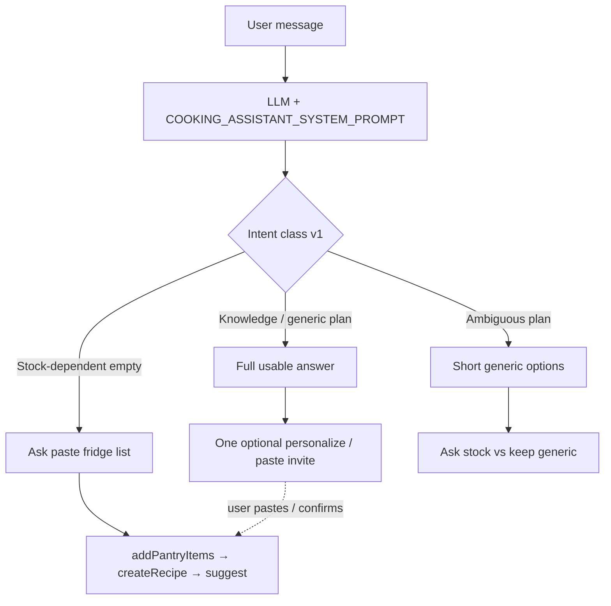

# Design: Empty-state value-first replies

**Feature:** [empty-state-value-first.md](../features/empty-state-value-first.md)  
**Status:** Implemented (Phases A–B)

---

## 1. Architecture overview

No new services, tables, or tools. Behavior change is confined to the **agent system prompt** (Phase A) and **client i18n / guest chrome copy** (Phase B).

**Relation to first-win-bootstrap:** Phase B paste orchestration stays. This design **adds a preceding branch** so knowledge asks never enter the “empty → refuse → homework” dead end.

---

## 2. Data model / schema

None. No migrations.

---

## 3. Interface design

### 3.1 System prompt (`backend-cf/src/agent/system-prompt.ts`)

Add a dedicated block **after** the existing empty-cook / first-win paste rules, clarifying precedence:

**Empty or sparse kitchen — reply policy**

1. **Classify intent** (prompt instructions, not a separate API):
   - **Knowledge / principle / generic plan** — answerable without on-hand stock (how-to, feeding principles, a default day-1 plan, technique, “typical first foods”).
   - **Stock-dependent** — cookability, “what can I make with what I have,” schedule that must match pantry, shortage shopping from current stock.
   - **Ambiguous** — plan/cook without stock cue → short generic value + one clarifying question.

2. **Knowledge / generic plan (empty OK):**
   - Lead with the answer (portions, steps, observation window, example day schedule as appropriate).
   - Do **not** open with “pantry is empty so I cannot help.”
   - Do **not** put the only useful content under “reminders” while the body is process meta (“I will add… create… tell you…”).
   - End with **one** optional invite: paste fridge/shopping list (or name staples) so we can adjust and, on approval, save via tools.
   - For infant / medical-adjacent topics: one short non-medical disclaimer; still deliver the usable default plan.

3. **Stock-dependent + empty pantry:** keep current rule — honest empty + paste short list; do not invent stock; do not send Inventory as the only path.

4. **Precedence:** If the ask is knowledge/generic plan, **do not** apply the stock-dependent empty refusal even if `listPantry` is empty. Calling `listPantry` is optional for knowledge asks; if called and empty, still answer first.

5. **Paste in same turn:** If the message includes a food list, run first-win orchestration; knowledge can be a short preamble if still useful.

### 3.2 Prompt contract tests (`system-prompt.test.ts`)

Assert the built prompt contains durable phrases / rules, e.g.:

- Value-first / answer-first for knowledge or generic-plan when empty.
- Must not lead with empty-pantry refusal for those intents.
- Paste-list / first-win still documented for stock-dependent empty cook.
- Still forbid inventing pantry without approval.

Exact assertion strings follow the final prompt wording (update tests with the prompt edit in the same task).

### 3.3 Guest copy (Phase B)

| Surface | Keys (approx.) | Direction |
|---------|----------------|-----------|
| Mobile banner | `auth.guestBanner`, `auth.guestBannerCta` | Benefit: keep pantry, recipes, and this kitchen when you save |
| Web guest | `landing.guestFooter`, `landing.guestSavePrompt`, `landing.guestSaveCta` | Same benefit language; keep one CTA |

No layout change required unless copy wraps badly on small screens — prefer tightening wording over new UI.

---

## 4. Business logic flow

### 4.1 Repro target (must pass after A)

**Given** empty pantry + empty recipes (guest or new auth user)  
**When** user sends 「規劃第一天副食品」  
**Then** main reply includes a usable day-1 complementary-feeding plan (e.g. single-ingredient thin puree / 十倍粥, small volume, one-at-a-time, 2–3 day observation)  
**And** paste/personalize is secondary  
**And** agent does not claim pantry/recipes were written without tools.

### 4.2 Regression (must still pass)

**Given** empty pantry  
**When** 「冰箱裡有什麼可以煮」 / 「用現有食材建議晚餐」  
**Then** honest empty + ask to paste list; no invented items.

### 4.3 Ambiguous

**When** 「幫我規劃晚餐」 with empty kitchen  
**Then** 1–2 concrete generic dinner ideas (or a simple default) + ask whether to tailor from a pasted list — not refuse-first.

---

## 5. Edge cases & error handling

| Case | Handling |
|------|----------|
| Knowledge + paste in one message | Short answer if needed → paste orchestration |
| User declines invite | Do not repeat homework; wait for next ask |
| Allergies in prefs on knowledge ask | If `getPreferences` already in context or easily called, honor allergies in the generic plan; do not block the answer waiting for pantry |
| Guest tool allowlist | Unchanged; knowledge answers are text-only until user approves mutators |
| Model still refuses | Prompt + contract tests; if production still fails, follow-up may add few-shot examples in prompt (same epic or hotfix) — do not add a classifier in v1 |

---

## 6. Performance & security

- **Performance:** No extra mandatory tool round-trips for pure knowledge asks (optional `listPantry` / `getPreferences` only when helpful).  
- **Security / trust:** Still no silent pantry writes; HITL unchanged.  
- **Safety copy:** Short disclaimer for infant/medical-adjacent; no clinical personalization claims.  
- **Abuse:** Guest quotas unchanged.

---

## 7. Risks

| Risk | Mitigation |
|------|------------|
| Prompt change weakens paste-first for stock asks | Explicit dual rules + regression smoke + contract tests for both paths |
| Long essays return | Reinforce “concise unless asked”; knowledge answers structured but short |
| Over-disclaimer | Cap at one short line |
| Copy length breaks mobile banner | Keep one line; zh/en editors review wrap |

---

## 8. Rollback

Revert `system-prompt.ts` (+ tests) and i18n keys. No data migration.

---

## 9. Implementation order

1. Edit system prompt + Vitest contract (Phase A).  
2. Manual smoke both intents.  
3. Update guest/save i18n en+zh (Phase B).  
4. Mark feature/tasks done.
