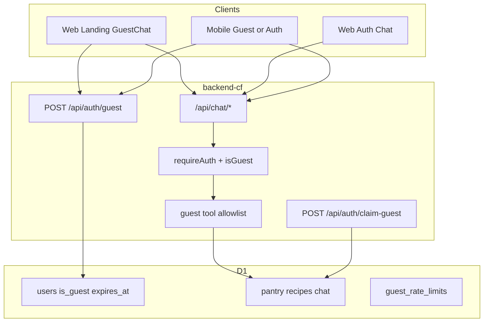

# Design: First-win bootstrap

**Feature:** [first-win-bootstrap.md](../features/first-win-bootstrap.md)  
**Status:** Implemented (Phases A–E)

---

## 1. Architecture overview



Phases A–B change clients + agent prompt only. Phase C adds guest identity and gates. Phases D–E wire guest entry UX.

---

## 2. Data model

### Migration `0010_guest_users.sql`

```sql
ALTER TABLE users ADD COLUMN is_guest INTEGER NOT NULL DEFAULT 0;
ALTER TABLE users ADD COLUMN expires_at INTEGER; -- unix seconds; null for real users

CREATE TABLE IF NOT EXISTS guest_rate_limits (
  id TEXT PRIMARY KEY,           -- hash of IP + bucket day
  ip_hash TEXT NOT NULL,
  bucket_day TEXT NOT NULL,      -- YYYY-MM-DD UTC
  mint_count INTEGER NOT NULL DEFAULT 0,
  chat_count INTEGER NOT NULL DEFAULT 0,
  updated_at INTEGER
);
CREATE INDEX IF NOT EXISTS idx_guest_rate_ip_day ON guest_rate_limits(ip_hash, bucket_day);
```

Guest user row:

| Field | Value |
|-------|--------|
| id | UUID |
| email | `guest-{id}@guest.lardermind.local` (unique, not loginable) |
| first_name / last_name / name | `Guest` |
| role | `guest` |
| is_guest | 1 |
| expires_at | now + GUEST_TTL_SECONDS (default 4h) |
| hashed_password | null |

Domain tables keep `user_id` FK — no per-row guest flag. Expiry is on the user row; purge cascades via FK.

---

## 3. JWT

Extend payload:

```ts
{ user_id: string, guest?: boolean, iat, exp }
```

- `signJwt(userId, secret, expiresInSeconds, { guest?: boolean })`
- `verifyJwt` returns `{ userId, isGuest: boolean }`
- Guest token `exp` ≤ user `expires_at`
- Auth middleware sets `c.set('userId')` and `c.set('isGuest', boolean)`

---

## 4. APIs

### `POST /api/auth/guest`

- Check IP rate limit (e.g. max 5 mints / IP / day).
- Create guest user + issue guest JWT.
- Response: `{ token, user: { id, is_guest: true, expires_at }, expires_in }`

### `POST /api/auth/claim-guest` (authenticated real user)

Body: `{ guest_token: string }` or `Authorization` was guest then upgrade — prefer body guest_token while Bearer is real user.

- Verify guest token; load guest user; reject if expired or already claimed.
- Reassign `user_id` on pantry_items, recipes (+ ingredients), chat_sessions, ai_messages, usage_quotas merge, folders as needed from guest → real user.
- Delete guest user row (cascade leftovers).
- Response: `{ claimed: true }`

Also accept `guest_token` optional on signup/signin/google-login to claim in one shot.

### Chat / domain

- `requireAuth` accepts guest JWT.
- Guest expired (`expires_at < now`) → 401 `guest_expired`.
- Mutating domain REST outside allowlist → 403 `{ code: 'signup_required' }`.
- Agent tool execute: if `isGuest` and tool not in allowlist → tool error / pending with signup message (prefer structured `signup_required` in stream).

### Guest tool allowlist

```ts
GUEST_TOOL_ALLOWLIST = new Set([
  'listPantry',
  'listMyRecipes',
  'getRecipeDetails',
  'getPreferences',
  'suggestMealsFromPantry',
  'addPantryItems',
  'createRecipe',
]);
```

All other tools → signup gate.

### Quotas

| Tier | AI msgs / day |
|------|----------------|
| Guest | **5** |
| Free | 20 (unchanged) |
| Pro | 200 |

### IP rate limits (defaults)

| Action | Limit |
|--------|--------|
| Guest mint | 5 / IP / UTC day |
| Guest chat send/stream | 20 / IP / UTC day |

Store IP as SHA-256 hash (no raw IP at rest).

### Cleanup

- Scheduled: `POST` internal or wrangler cron trigger → `DELETE FROM users WHERE is_guest = 1 AND expires_at < now` (cascade).
- Lazy: on guest auth, if expired → 401 and best-effort delete.

---

## 5. Agent / Phase B prompt contract

In `system-prompt.ts`, add first-win block:

When user pastes a fridge/shopping list (or empty pantry + cook intent):

1. Parse items → `addPantryItems` (HITL). Do not invent stock.
2. After approve, propose 1–3 recipes via `createRecipe` matching those items (HITL).
3. After recipe(s) exist, call `suggestMealsFromPantry` and present the card.
4. Never claim cookable before pantry + recipes exist.

Empty pantry cook ask without a list: ask them to paste a short list (do not only say “go to Inventory”).

---

## 6. UX

### Setup Guide (Phase A)

- Stop mounting `<SetupGuide>` in `App.tsx`.
- On app load (auth): remove `lardermind.setupGuide.dismissed` / `chatStarted` keys (optional cleanup).
- Mark feature doc superseded.

### Chat empty (Web + Mobile)

- Show `ai.emptyHint`.
- Primary suggestion: paste fridge list prompt.
- Secondary: cook with what I have (after list).
- Demote “Add items to pantry” and Inventory/Shopping chips from peer-primary (hide chips or move below).

### Landing (Phase D)

- New `GuestChatBox` (or evolve DemoChatBox): mint guest, use real `chat` stream API, render HITL + meal cards.
- After first successful suggestions: CTA “Save my kitchen” → signup with guest_token in sessionStorage.
- Scripted `DemoChatBox` removed as primary; keep file only if needed for offline marketing fallback — default path is real guest.

### Mobile (Phase E)

- Login screen: “Try without account” → mint → store token as guest → Main drawer Chat.
- Guest banner: “Save to keep your kitchen” → signup/claim.
- Blocked tool / 403 signup_required → modal to signup.

---

## 7. Security

- Guest emails not usable for password login.
- Claim requires valid unexpired guest token + authenticated non-guest user.
- IP hash only in rate table.
- Stricter AI quota than free.
- No Turnstile in v1 (monitor abuse; add later if needed).

---

## 8. Testing

- Unit: JWT guest claim; allowlist gate; quota guest branch; rate limit.
- Integration: mint → chat paste path tools; blocked tool → signup_required; claim migrates pantry/recipes.
- Prompt contract tests for first-win orchestration strings.
- Frontend: SetupGuide not mounted; empty state keys present.

---

## 9. Rollback

- Feature flag optional: `GUEST_AUTH_ENABLED` env (default on in local/dev).
- Re-mount SetupGuide by reverting App.tsx mount if needed.
- Disable `/api/auth/guest` → clients fall back to signup CTA.
