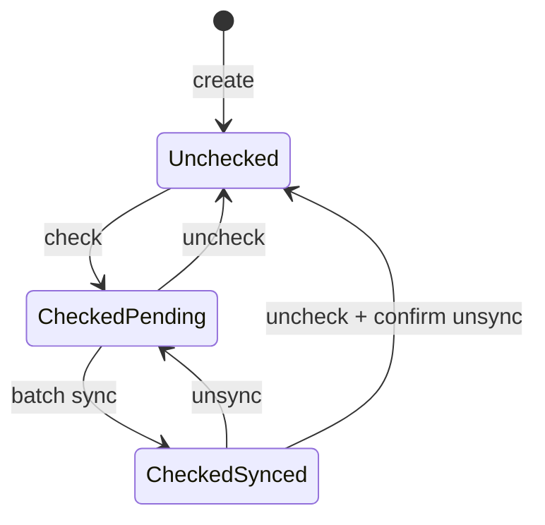
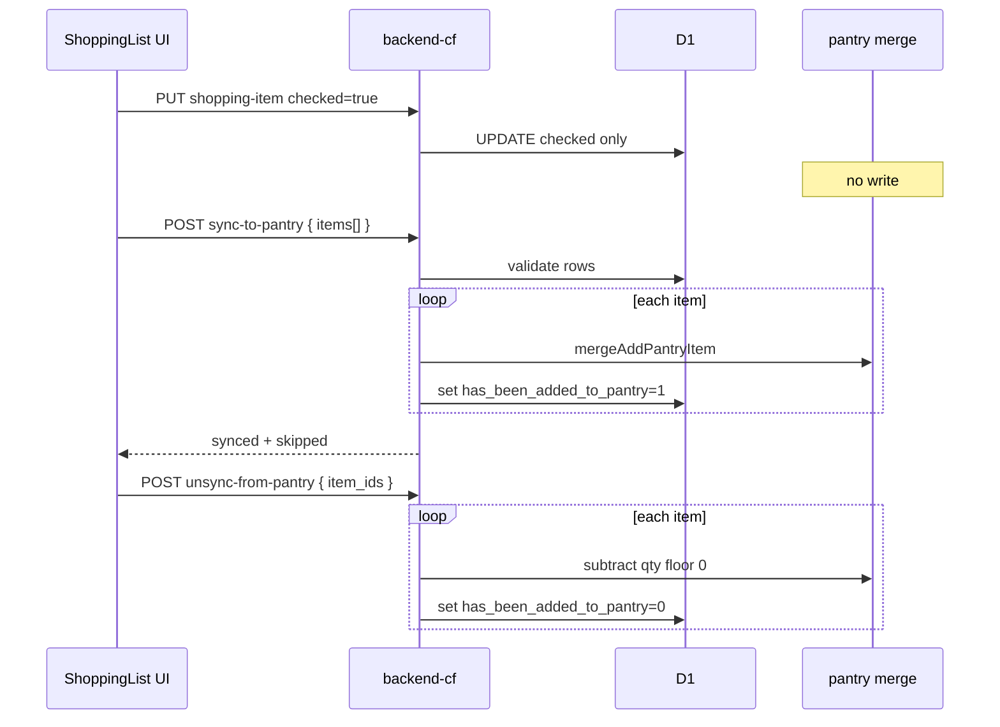

# Technical Design: Shopping list batch sync to pantry

**Feature reference:** [shopping-pantry-batch-sync.md](../features/shopping-pantry-batch-sync.md)  
**Status:** Implemented  
**Scope:** `backend-cf` + web (`frontend/client/`) + mobile (`mobile/`)  
**Out of scope:** Unit conversion engine, pantry location, `backend/` Spring parity in v1

---

## 1. Architecture overview

### 1.1 State machine (per shopping row)



| Field | Meaning |
|-------|---------|
| `checked` | User marked purchased on shopping list |
| `has_been_added_to_pantry` | Quantity merged into pantry for this row |

**Key change:** Transitions on `checked` alone **no longer** call `mergeAddPantryItem` / subtract.

### 1.2 Component flow



---

## 2. Backend (`backend-cf`)

### 2.1 Files to change

| File | Change |
|------|--------|
| `src/db/shopping-list.ts` | Remove pantry calls from `create`/`update` on check; add `syncItemsToPantry`, `unsyncItemsFromPantry` |
| `src/routes/shopping-list.ts` | New routes; extend DTO with `synced_to_pantry` |
| `src/routes/domain-crud.test.ts` | Replace check→pantry tests with batch sync tests |
| `migrations/` | **None required** — reuse `has_been_added_to_pantry` |

### 2.2 DTO change

```ts
export type ShoppingListItemDto = {
  id: string;
  name: string;
  quantity: number;
  unit: string;
  checked: boolean;
  synced_to_pantry: boolean; // maps has_been_added_to_pantry === 1
  ingredient_id?: string;
  details: { ...; synced_to_pantry: boolean };
};
```

Clients use `synced_to_pantry` for badges and pending-sync counts.

### 2.3 Decouple check from pantry

In `updateShoppingListItem` and `createShoppingListItem`:

- **Remove** calls to `syncPantryOnCheck` / `syncPantryOnUncheck` on `checked` transitions.
- **Do not** auto-set `has_been_added_to_pantry` on create with `checked: true`.
- `has_been_added_to_pantry` changes **only** via sync / unsync endpoints (or legacy data).

Keep helper functions `syncPantryOnCheck` / `syncPantryOnUncheck` — reused by batch ops.

### 2.4 New DB functions

```ts
type SyncToPantryItemInput = {
  id: string;
  quantity?: number; // override shopping row
  unit?: string;
};

type SyncToPantryResult = {
  synced: ShoppingListItemDto[];
  skipped: { id: string; reason: string }[];
};

async function syncItemsToPantry(
  db, userId,
  items: SyncToPantryItemInput[],
): Promise<SyncToPantryResult>

async function unsyncItemsFromPantry(
  db, userId,
  itemIds: string[],
): Promise<{ unsynced: ShoppingListItemDto[]; skipped: ... }>
```

**Per-item sync logic:**

1. Load row; 404 → skip `not_found`.
2. If `has_been_added_to_pantry === 1` → skip `already_synced`.
3. If `checked !== 1` → skip `not_checked`.
4. Resolve qty/unit from input override or row.
5. `mergeAddPantryItem(...)`; set flag `1`; append to `synced`.

**Unsync logic:** (inverse of current uncheck path)

1. If flag `0` → skip.
2. Subtract row quantity from matching pantry (ingredient_id then CI name); floor 0.
3. Set flag `0`.

All updates in a loop (v1). If any merge throws, return 500 with partial state documented — prefer sequential with per-item try or single transaction; **v1: sequential, fail-fast on first DB error after at least one success returns 207-style body** — simplify to **all-or-nothing in one batch** via D1 batch API if ≤100 items.

**Recommendation:** Use `db.batch()` for flag updates + accept sequential pantry merges (existing pattern).

### 2.5 HTTP routes

#### `POST /api/shopping-list/sync-to-pantry`

```json
{
  "items": [
    { "id": "uuid", "quantity": 2, "unit": "包" }
  ]
}
```

| Validation | Response |
|------------|----------|
| `items` missing or empty | `400` |
| `items.length > 100` | `400` |
| All skipped | `200` with empty `synced` |

```json
{
  "success": true,
  "data": {
    "synced": [ /* ShoppingListItemDto[] */ ],
    "skipped": [ { "id": "...", "reason": "already_synced" } ]
  }
}
```

#### `POST /api/shopping-list/unsync-from-pantry`

```json
{ "item_ids": ["uuid1", "uuid2"] }
```

Same envelope with `unsynced` / `skipped`.

Auth: existing `requireAuth` on shopping-list routes.

### 2.6 Eligibility (server vs client)

**v1:** Server does **not** enforce `ingredient_id` filter — client preselects in review sheet. Server only validates checked + not already synced. Rationale: user may intentionally sync a manual “醬油” row without ingredient_id.

**v2 (optional):** `eligible_for_pantry` column — not in v1.

### 2.7 Regression test plan

| # | Test |
|---|------|
| T1 | PUT check true → pantry unchanged; flag stays 0 |
| T2 | POST sync → pantry +qty; flag 1; second sync skips |
| T3 | POST unsync → pantry −qty floor 0; flag 0 |
| T4 | PUT uncheck pending → flag stays 0, pantry unchanged |
| T5 | Create with checked true → pantry unchanged until sync |
| T6 | Sync with qty override → pantry uses override |

Remove or rewrite existing `checking a shopping item adds quantity to pantry` test.

---

## 3. Web client (`frontend/client/`)

### 3.1 Context / API

| File | Change |
|------|--------|
| `src/api/shoppingList.ts` (or equivalent) | `syncToPantry`, `unsyncFromPantry`; parse `synced_to_pantry` |
| `src/contexts/pantryContext.tsx` | After sync, refresh pantry + shopping list |

### 3.2 UI (`ShoppingList` component / screen)

- Pending sync count from `items.filter(checked && !synced_to_pantry)`.
- Footer CTA → opens review sheet modal.
- Sheet: checkbox list, qty/unit inputs, confirm → API → toast with undo.
- Undo: call `unsyncFromPantry` with last batch ids; refresh contexts.

### 3.3 Uncheck synced item

Modal confirm → if yes, `unsyncFromPantry([id])` then PUT `checked: false`.

---

## 4. Mobile client (`mobile/`)

Mirror web behavior on `ShoppingListScreen.tsx` + `pantryContext.tsx`.

**Offline:** `sync-to-pantry` requires network. If offline queue has pending check mutations, allow checks locally; batch button disabled with copy referencing online requirement (align with `docs/features/offline-shopping-list.md`).

---

## 5. i18n keys (minimum)

| Key | zh | en |
|-----|----|----|
| `shopping.syncToPantry` | 將 {n} 項加入庫存 | Add {n} items to pantry |
| `shopping.pendingSync` | 待入庫 | Pending pantry sync |
| `shopping.syncedToPantry` | 已入庫 | In pantry |
| `shopping.syncReviewTitle` | 加入廚房庫存 | Add to kitchen inventory |
| `shopping.syncNonFoodHint` | 無食材連結的項目通常不需加入庫存 | Items without ingredient link usually skip pantry |
| `shopping.syncSuccess` | 已將 {n} 項加入庫存 | Added {n} items to pantry |
| `shopping.undo` | 復原 | Undo |
| `shopping.uncheckSyncedConfirm` | 此項目已加入庫存，取消勾選是否一併扣除？ | Remove from pantry too? |

---

## 6. Rollout & risks

| Risk | Mitigation |
|------|------------|
| Users on old app expect check→pantry | Release note; ship web+mobile together |
| Pending legacy checked rows (flag 0) | Show in batch CTA after upgrade |
| Partial batch failure | Document; v1 fail-fast with no partial flag updates OR use batch transaction |
| Double-add if old + new client mixed | Flag gate unchanged |

**Rollback:** Revert Worker to check-side-effect sync; clients without batch UI still work.

---

## 7. Alternatives considered

| Alternative | Verdict |
|-------------|---------|
| Per-check Smart Prompt | Rejected as default — too interruptive; batch is primary |
| Server-only ingredient_id filter | Rejected v1 — blocks intentional manual food adds |
| Client-only sync (POST pantry bulk) | Rejected — loses shared flag semantics, race-prone |
| Keep check→pantry + settings toggle | Deferred — add `shopping_sync_mode` in v2 if requested |

---

## 8. Task mapping

See `tasks/shopping-pantry-batch-sync/README.md`.
